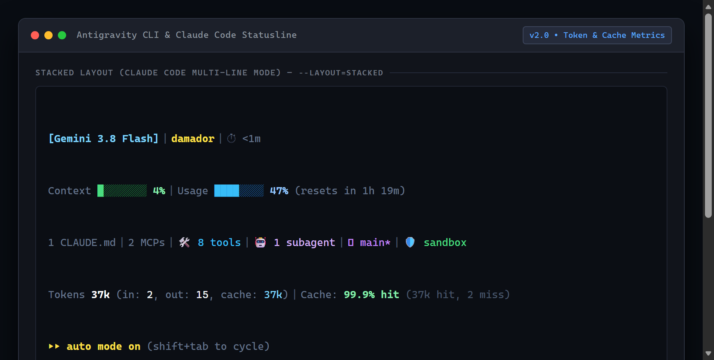
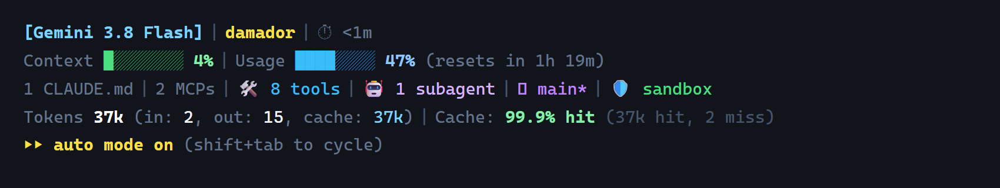

# Antigravity Scripts

Katalog zawiera skrypty rozszerzające i integrujące się z narzędziem **Google Antigravity CLI (`agy`)** oraz **Claude Code**.

---

## statusline.js

> **Cross-platform (Windows / macOS / Linux)** — wymaga środowiska Node.js (v18+).



Własny, responsywny i wysoce konfigurowalny pasek stanu (statusline) dla **Antigravity CLI (`agy`)** oraz **Claude Code**. Skrypt odbiera obiekt stanu sesji w formacie JSON ze standardowego wejścia (`stdin`) i generuje kolorowy pasek w stopce interfejsu TUI w jednym z dwóch układów: **wielowierszowym (stacked / styl Claude Code)** lub **adaptacyjnym jednoliniowym (inline)**.

### Podgląd układów

#### 1. Układ wielowierszowy (Stacked / Claude Code style) — `--layout=stacked`


Odpowiada dokładnie 5-poziomowemu układowi znanemu z Claude Code:
- **Wiersz 1:** `[Model] | Użytkownik | ⏱ Czas trwania sesji`
- **Wiersz 2:** `Context [bar] % | Usage / Quota [bar] % (resets in ...)`
- **Wiersz 3:** `Pliki reguł | MCPs | 🛠️ Narzędzia | 🤖 Podagenci |  Git | 🛡️ Piaskownica`
- **Wiersz 4:** `Tokens X (in: X, out: X, cache: X) | Cache: XX% hit (hit/miss)`
- **Wiersz 5:** `▸▸ Stan agenta / Tryb wykonania (auto mode)`

#### 2. Układ adaptacyjny jednoliniowy (Inline) — `--layout=inline`
Responsywny pasek jednoliniowy z dynamicznym dopasowaniem segmentów do szerokości okna (`terminal_width`), eliminujący nieestetyczne zawijanie wierszy w węższych terminalach.

---

### Kluczowe możliwości

- **Szczegółowe metryki tokenów (in / out / cache)** — precyzyjne rozbicie zużycia tokenów:
  `Tokens 37k (in: 2, out: 15, cache: 37k)`.
- **Wskaźnik Cache Hit / Miss** — procent trafień w pamięć podręczną prompt cache oraz liczby tokenów obsłużonych z cache vs przetworzonych na nowo (np. `Cache: 99.9% hit (37k hit, 2 miss)` lub `⚡ 99.9% hit`).
- **Wykorzystanie narzędzi (Tool Usage)** — sumaryczna liczba wykonanych operacji narzędziowych (`🛠️ 86 tools`), aktywne narzędzie oraz rozbicie najpopularniejszych poleceń.
- **Podagenci (Subagents)** — bieżący licznik uruchomionych i aktywnych instancji podagentów (`🤖 2 subagents`).
- **Wykrywanie MCP oraz plików reguł** — automatyczne zliczanie aktywnych serwerów MCP (`4 MCPs`) i plików konfiguracyjnych projektu (`CLAUDE.md`, `GEMINI.md`, rules).
- **Wizualny pasek Context Window** — graficzny pasek postępu zużycia tokenów z adaptacyjnymi kolorami:
  - Zielony: poniżej 60%
  - Żółty: 60% – 85%
  - Czerwony: powyżej 85%
- **Wskaźnik stanu agenta** — czytelne odznaki (`● IDLE`, `⚡ WORKING`, `⚙ TOOL`, `🔍 REVIEW`, `🔑 AUTH`, `⏳ INIT`, `✖ ERROR`).
- **Wysoka wydajność i brak zależności** — czysty Node.js (moduły standardowe), przyrostowy odczyt transkryptu z cache'owaniem plikowym poniżej 2 ms.

---

### Konfiguracja w Antigravity CLI

#### Sposób 1: Bezpośrednio w CLI przez Slash Command

##### Układ wielowierszowy (stacked / Claude style):
```text
/statusline node <pełna-ścieżka-do-skryptu>/statusline.js --layout=stacked
```

##### Układ jednoliniowy (adaptacyjny):
```text
/statusline node <pełna-ścieżka-do-skryptu>/statusline.js
```

> [!NOTE]
> **Wskazówka dla Windows:** Nie otaczaj ścieżki zewnętrznymi cudzysłowami (np. `"C:\..."`), ponieważ CLI przekaże je dosłownie do procesu Node.js, powodując błąd modułu. Zamiast tego użyj ukośników `/` lub podwójnych `\\`, np.:
> ```text
> /statusline node C:/Users/TwojUzytkownik/Documents/Code/skrypty/antigravity/statusline.js --layout=stacked
> ```

#### Sposób 2: Plik konfiguracyjny `settings.json`
Dodaj lub zmodyfikuj sekcję `statusLine` w pliku `~/.gemini/antigravity-cli/settings.json`:

```json
{
  "statusLine": {
    "type": "command",
    "command": "node C:\\Users\\TwojUzytkownik\\Documents\\Code\\skrypty\\antigravity\\statusline.js --layout=stacked"
  }
}
```

Możesz także zdefiniować układ domyślny za pomocą zmiennej środowiskowej:
- `STATUSLINE_LAYOUT=stacked` (lub `inline`)
- `STATUSLINE_STYLE=claude`

---

### Opcje wiersza poleceń i tryby pracy

| Opcja | Opis |
|---|---|
| `--layout=stacked` | Układ wielowierszowy (5 poziomów metryk w stylu Claude Code). |
| `--layout=inline` | Układ jednoliniowy, responsywnie dopasowujący się do szerokości okna (domyślny). |
| `--style=claude` | Synonim dla `--layout=stacked`. |
| `--demo` | Uruchamia demonstrację układu wielowierszowego Claude, metryk Antigravity oraz trybu adaptacyjnego. |
| `--test` | Wykonuje natychmiastowy test z przykładowym ładunkiem JSON. |
| `--style=<name>` | Wybór stylu separatorów: `default` (`│`), `minimal` (`•`), `powerline` (``). |
| `--ascii` | Wymusza użycie wyłącznie podstawowych znaków ASCII (brak symboli Unicode / Nerd Fonts). |
| `--no-color` | Wyłącza sekwencje kolorów ANSI (respektuje także zmienne `NO_COLOR=1` oraz `NODE_DISABLE_COLORS=1`). |
| `--help` | Wyświetla ekran pomocy ze szczegółowym opisem parametrów. |

### Przykłady uruchomienia

```bash
# Pełna demonstracja układu wielowierszowego (Claude style) i jednoliniowego
node statusline.js --demo

# Szybki test działania w układzie wielowierszowym
node statusline.js --test --layout=stacked

# Szybki test działania w układzie jednoliniowym
node statusline.js --test

# Test w trybie czystego ASCII
node statusline.js --test --ascii
```
